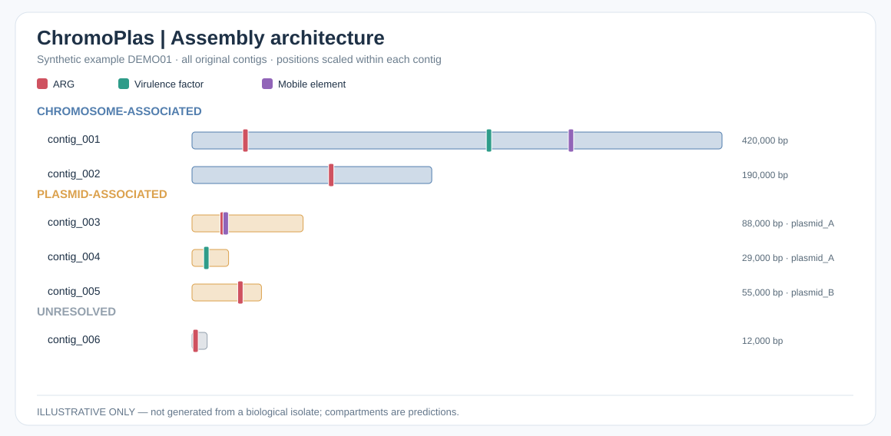
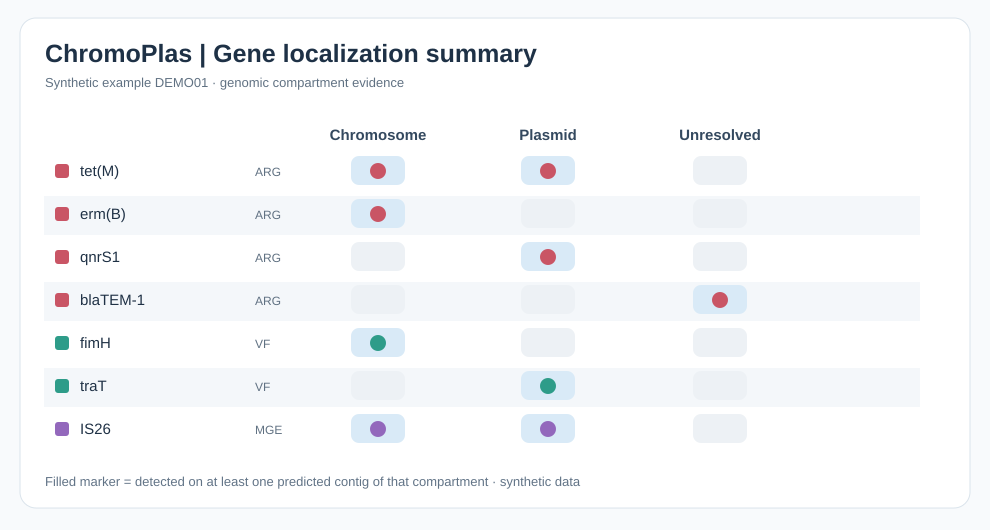

# ChromoPlas

**From assembled bacterial FASTA to antimicrobial-resistance screening and chromosome–plasmid localization figures.**

ChromoPlas is an open-source Python/Snakemake workflow using ABRicate and MOB-suite to identify ARG/VF/replicon hits, map hits to original contig coordinates, predict their chromosome/plasmid association, and produce SVG, TSV and HTML reports.


## 1. Install on Ubuntu / Debian / WSL2 (beginner-friendly)

**Requirements:** Linux x86_64, Git, an internet connection and free storage for Conda tools and reference databases. This runs **inside Ubuntu/WSL**, not Windows PowerShell; Bash and Zsh users can both execute it. Conda does **not** need to be installed beforehand.

Open your Linux terminal and copy these **three commands**:


```bash
git clone https://github.com/afsansarwer/ChromoPlas.git
cd ChromoPlas
bash INSTALL.sh
```

The installer finds your existing Miniconda/Miniforge (or installs Miniforge if missing), creates a separate `chromoplas` Conda environment, installs Snakemake, ABRicate, MOB-suite, the ChromoPlas CLI, initializes required databases, and runs installation checks. **It does not install into `(base)`.** Database downloads may be large. If an operation fails, the script stops instead of reporting success.

**Already cloned?** Run only `bash INSTALL.sh` from inside that repository. Running `git clone` alone is not installation; `chromoplas: command not found` before setup is expected.

## 2. Activate and verify

After installation completes, run in the same Linux/WSL terminal:


```bash
conda activate chromoplas
chromoplas --help
chromoplas doctor
```

A new terminal starts a new shell session, so reactivate it with `conda activate chromoplas`. If activation is unavailable, follow the path printed by the installer or see [troubleshooting](docs/troubleshooting.md).

## 3. Try it and analyze your genomes

**Check a bundled test input without running the full analysis:**


```bash
chromoplas examples/genomes/test_isolate.fna -o ~/chromoplas-preview --dry-run
```

**Run on your own assembled bacterial genome** (replace the input path with your actual FASTA):


```bash
chromoplas ~/genomes/genome.fna -o ~/chromoplas-results -t 4

# Analyze a directory of assembled genomes independently
chromoplas ~/genomes/ -o ~/chromoplas-batch -t 8
```

**Open your results:** `~/chromoplas-results/07_reports/report.html` (open from your file manager or browser). On desktop Linux, you can try:


```bash
xdg-open ~/chromoplas-results/07_reports/report.html
```

**WSL tip:** Keep genome input and output under your Linux home directory (`~/`) for faster I/O than `/mnt/c/` or `/mnt/e/`; your Git clone can remain on Windows storage. Inputs are assembled FASTA files (`.fa`, `.fna`, `.fasta`, optionally gzipped), **not FASTQ**.

## What does ChromoPlas produce?

| Stage | Tool | Output |
| --- | --- | --- |
| QC | ChromoPlas | Contig count, genome size, N50, GC%, PASS/FAIL |
| Gene detection | ABRicate | ResFinder ARGs, VFDB VFs, PlasmidFinder replicons |
| Contig assignment | MOB-suite | Predicted chromosome, plasmid or unresolved |
| MGE evidence | Available MOB-suite reports | Coordinate-resolved matches when available |
| Visualization | ChromoPlas | Architecture SVG, gene-localization matrix SVG, HTML report |

Results include per-sample `06_localization/<sample>/architecture.svg`, `gene_localization_matrix.svg`, `feature_localization.tsv` and `07_reports/report.html`. Every genome is processed independently; ChromoPlas is **not** a pangenome analysis tool.

## Example figures (synthetic demonstration, not real isolates)





[Demo gallery](docs/demo-gallery.md)

## Detailed guides

- **[Installation and troubleshooting](INSTALL.md)**, including a manual Conda setup.
- **[Debian/Ubuntu and WSL2 installation](docs/install-debian.md)** and [Windows/WSL2 setup](docs/install-windows-powershell.md).
- [Omarchy/Arch setup](docs/install-omarchy.md) · [macOS (experimental)](docs/install-macos.md).
- [Beginner's guide](docs/beginners-guide.md) · [Command reference](command_help.md) · [Update tools/databases](docs/updating.md).
- [Scientific validation and limitations](docs/validation.md) · [Contributing](CONTRIBUTING.md) · [Citations](CITATION.md) · [MIT License](LICENSE).

**Release:** v0.3.0 public beta / research prototype. Successful real-genome execution has been demonstrated on Omarchy Linux, but independent plasmid-location benchmarking and full cross-platform validation are still pending. Gene and contig locations are computational predictions, not experimental or clinical confirmation.
