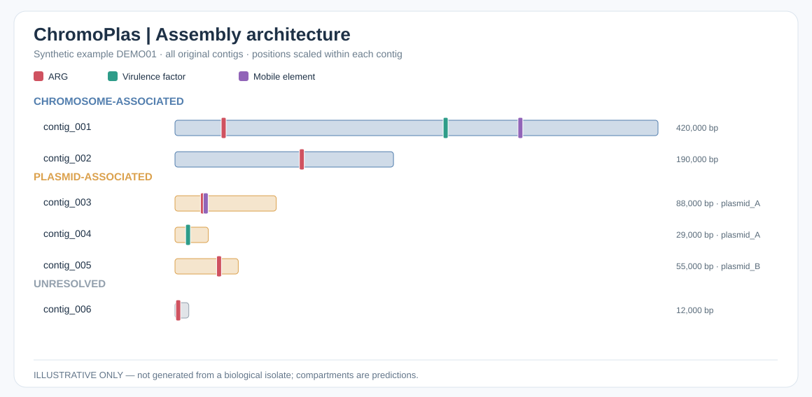
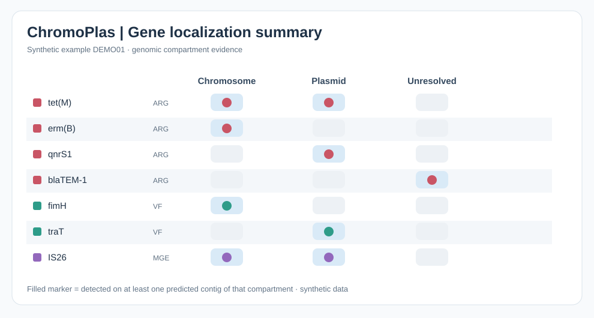

# ChromoPlas demonstration gallery

These figures use **synthetic, illustrative data**. No real sample sequences or personal information appear in these examples.

## 1. Whole-assembly architecture

The track length shows the relative length of each assembled contig. Blue tracks are chromosome-associated, amber tracks are plasmid-associated and gray tracks are unresolved. Red markers indicate ARGs, green indicate VFs and purple indicate MGE matches. Plasmid-cluster labels connect multiple contigs assigned to one predicted plasmid group.

## 2. Gene localization matrix (illustrative example)

This gallery SVG is synthetic, while the actual workflow generates `gene_localization_matrix.svg` per sample. The matrix distinguishes a feature detected on a predicted chromosome, plasmid or unresolved contig. A feature may be detected in more than one compartment; a shared gene name is **not** proof of direct transfer.

## Where a real run saves files

- `results/06_localization/<sample>/architecture.svg` — each-isolate genome architecture map.
- `results/06_localization/<sample>/gene_localization_matrix.svg` — generated from each genome's own gene-localization summary.
- `results/06_localization/<sample>/feature_localization.tsv` — contig-specific detected gene positions.
- `results/06_localization/<sample>/gene_localization_summary.tsv` — gene locations.
- `results/07_reports/report.html` — combined browser report.

See the [beginner guide](beginners-guide.md) to run the pipeline on an assembled bacterial genome.